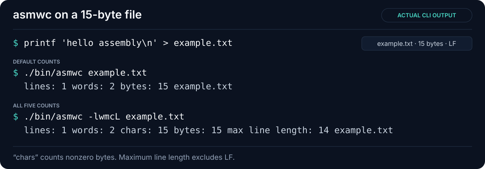
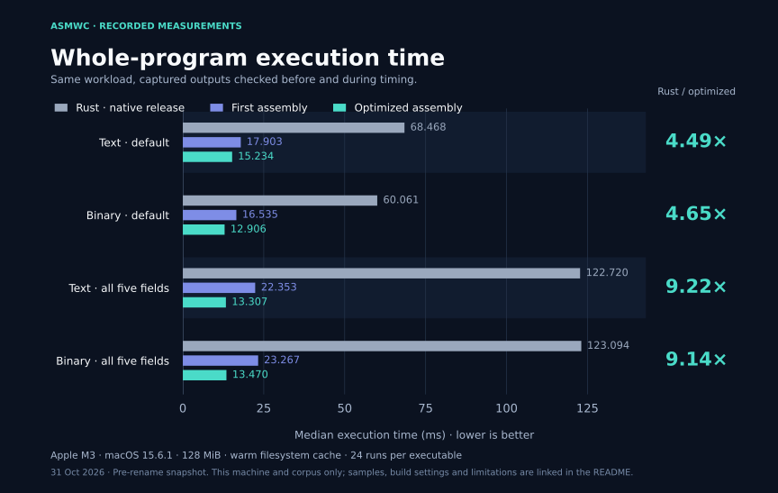
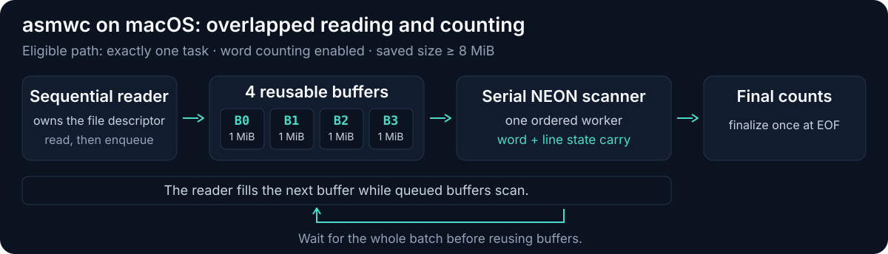

# ripwc-asm

[](https://github.com/stubbi/ripwc-asm/actions/workflows/ci.yml)

An experimental Apple Silicon implementation of [ripwc](https://github.com/LuminousToaster/ripwc), written in ARM64 assembly with NEON scanning. It reproduces upstream commit [`de1a12e`](https://github.com/LuminousToaster/ripwc/tree/de1a12e8e2d7c031404370773e5099b23ef01e95), including its differences from GNU/POSIX `wc`.

Parsing, traversal policy, counting, aggregation, and formatting are assembly. macOS libc provides operating-system services; libdispatch schedules work. The executable links to libSystem and has no C or Rust application wrapper. C is used only in test harnesses.



## Build and run

Building the assembly executable requires **Apple Silicon macOS** and **Xcode Command Line Tools**. The default build is tuned for Apple M3; the recorded validation platform is M3 on macOS 15.6.1. For an earlier Apple Silicon chip, select its compiler target, for example `make CPU=apple-m1`. Linux and Intel Macs are outside the current scope.

```sh
git clone https://github.com/stubbi/ripwc-asm.git
cd ripwc-asm
make
./bin/ripwc --help
```

```sh
./bin/ripwc file.txt            # lines, words, and bytes
./bin/ripwc -lwmcL file.txt     # all five count fields
./bin/ripwc -r directory       # recursive traversal
./bin/ripwc -- -dash-file      # a filename beginning with '-'
```

For example, a file containing `hello assembly` followed by LF produces:

```text
lines: 1 words: 2 bytes: 15 example.txt
```

Paths are required; `-` means a literal filename. There is no standard-input mode. Word separators are exactly space, tab, LF, and CR. `-m` counts nonzero bytes, and `-L` counts bytes between LF characters. Zero fields are omitted. Read the [compatibility contract](docs/COMPATIBILITY.md) before substituting this for another counting tool.

## Measured performance

On one **8-core Apple M3, 16 GiB, macOS 15.6.1**, the optimized assembly was **4.49–4.65× faster** than the pinned, natively optimized Rust implementation for default counting, and **9.14–9.22× faster** for all five fields. Each large input was 128 MiB; these are warm-cache, whole-program medians from 24 samples per implementation, recorded on 31 October 2026.



| Workload | Native Rust | Assembly | Rust / assembly |
|---|---:|---:|---:|
| Text, default | 68.468 ms | 15.234 ms | 4.49× |
| Binary, default | 60.061 ms | 12.906 ms | 4.65× |
| Text, all five fields | 122.720 ms | 13.307 ms | 9.22× |
| Binary, all five fields | 123.094 ms | 13.470 ms | 9.14× |

The [benchmark report](docs/BENCHMARKS.md) includes the preserved first assembly implementation, all workloads, confidence intervals, limitations, and reproduction instructions. The [recorded evidence](benchmarks/results/apple-m3-2026-10-31/) includes raw samples, corpus identities, build details, and verification reports.

These results describe this machine and these implementations. Large single-file word-counting jobs overlap reading and scanning; Rust uses a single reader/scanner for those jobs. Small-file measurements also include runtime startup differences. No cold-storage or cross-machine speed claim is made.

## Verify and benchmark

Verification additionally requires **Python 3.11+** and **Rust/Cargo 1.97.1**, pinned by `rust-toolchain.toml`. Python scripts use only the standard library. Rust is needed to build the unchanged upstream comparison executable; it is not needed to build or run the assembly program. The first baseline build needs network access to fetch locked Cargo dependencies.

```sh
make baselines   # pinned Rust and preserved first assembly
make test        # build missing baselines and run the full native test suite
make check       # portable repository, evidence, and benchmark-contract checks
make bench       # balanced three-way benchmark, 128 MiB, 24 samples each
```

The recorded validation passed **445 end-to-end cases**, **576 CLI differential cases**, and **128 parser-state combinations**, plus kernel, guard-page, register-preservation, pipeline setup-failure, and benchmark-contract tests. Differential tests compare stdout, stderr, and exit status against pinned upstream Rust; only explicitly parallel verbose message ordering is normalized. Passing these tests establishes equivalence for the tested cases.

Generated executables, local reports, and benchmark corpora are excluded from version control. The committed benchmark snapshot is separate from newly generated `results/` files. Rebuilt executable hashes can differ from the recorded ones; the benchmark report explains the snapshot's provenance.

## How it works



The reader and scanner overlap work while retaining sequential reads to EOF and ordered count state. Smaller and multiple-file jobs use their own paths, described in the [architecture guide](docs/ARCHITECTURE.md).

## Project guide

- [Architecture](docs/ARCHITECTURE.md): source map, scanner state, scheduling, and I/O design.
- [Compatibility](docs/COMPATIBILITY.md): counting rules, CLI behavior, traversal, and known limits.
- [Benchmarks](docs/BENCHMARKS.md): methodology, full results, and reproduction.
- [Contributing](CONTRIBUTING.md): correctness and measurement expectations.
- [Changelog](CHANGELOG.md): changes in this repository.
- [README graphics](docs/assets/README.md): captured output, chart data, and regeneration.

## Attribution and license

Based on [LuminousToaster/ripwc](https://github.com/LuminousToaster/ripwc) at commit `de1a12e8e2d7c031404370773e5099b23ef01e95` (19 May 2025). Its unchanged Rust source, manifest, and license are retained in [`upstream/`](upstream/); the comparison dependency graph is fixed by `upstream/Cargo.lock`. [`history/original-src/`](history/original-src/) preserves the first assembly implementation used as the optimization baseline.

Licensed under [GPL-3.0](LICENSE). The upstream license is also preserved at [`upstream/LICENSE`](upstream/LICENSE).
